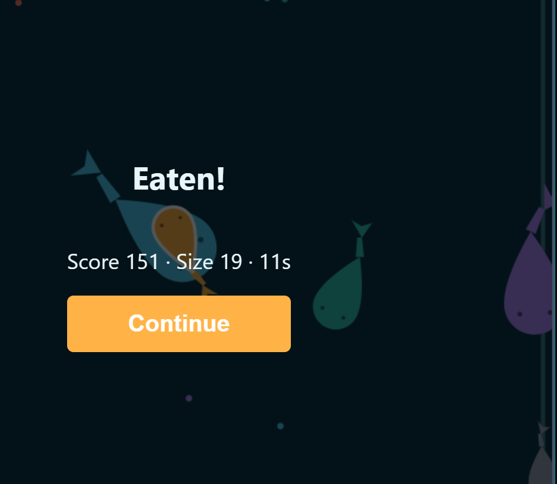
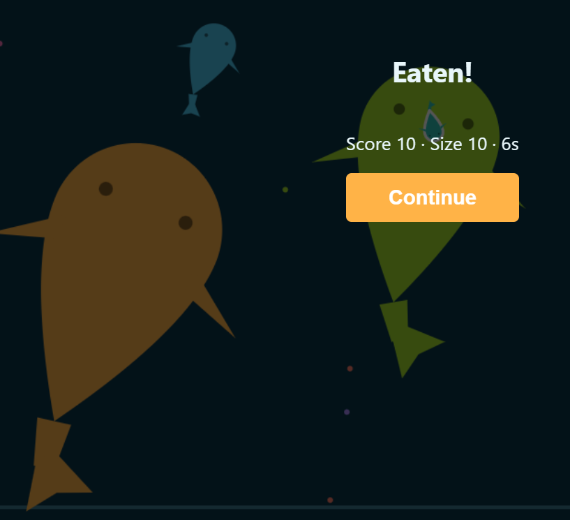
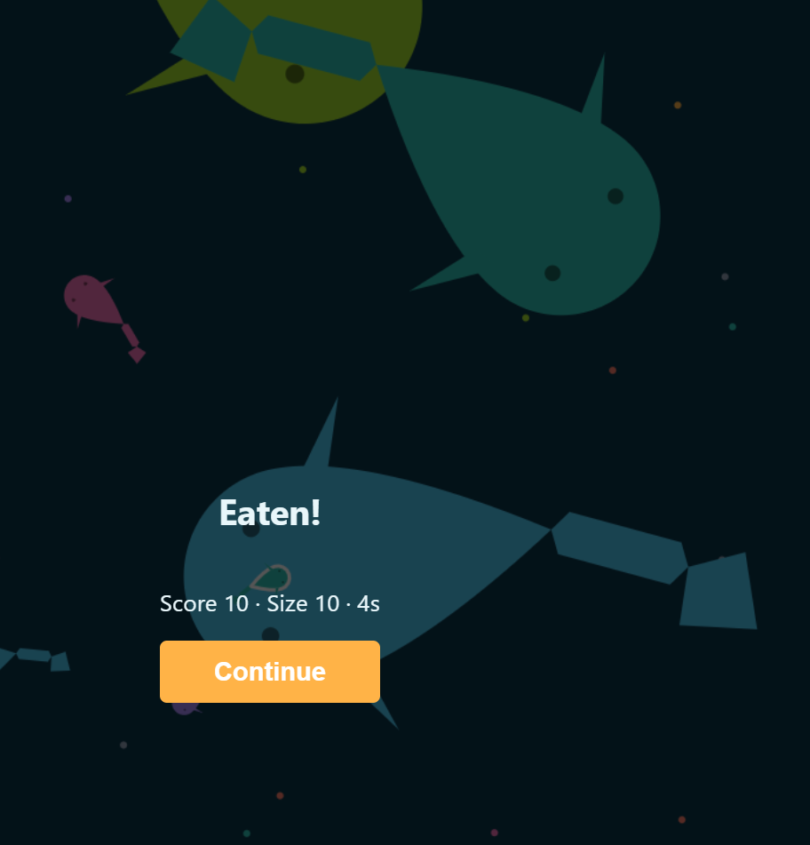
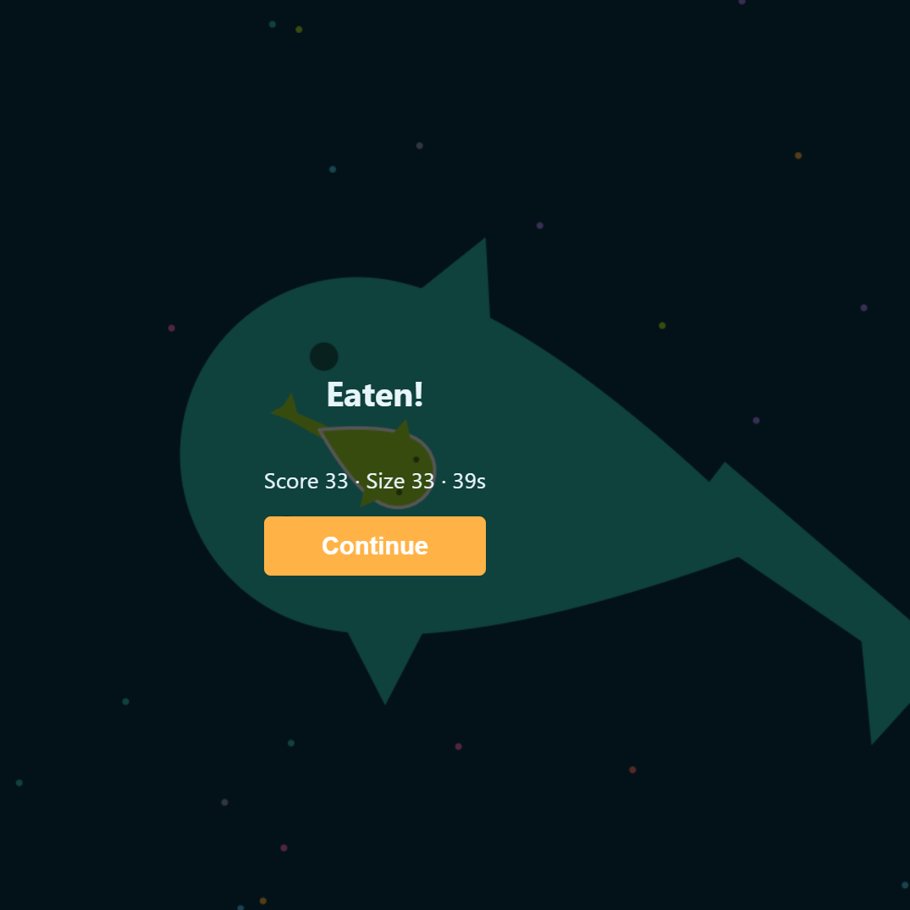
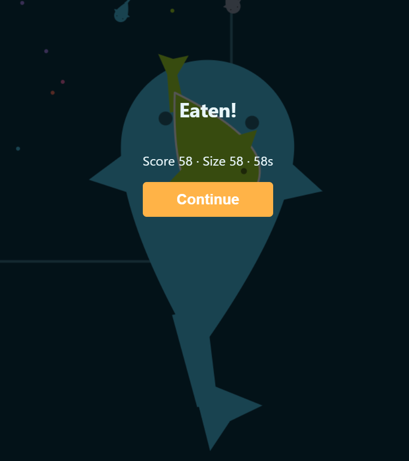

# Process overview

I started with a plan rather than code: [`a935ac5`](https://github.com/comp4020-agentic-coding-studio/comp4020-final-quackyduck826/commit/a935ac5) sketched the concept (an .io-style fish game, bots standing in for other players) and what "good" meant for the week before anything existed.

One of the first things that i did was add two clauses into the CLAUDE.md file, the first being to not edit any of the process/readme/other documentation files without permission and the second to commit and push often but only update the fly server when asked. Because I have a more hands off aproach to guiding claude that menat that when running free in auto mode it wouldn't get ahead of itself and start making up reasons it has to do things certain ways because its following whats in the files' that it also wrote moments before. especially when making large amounts of puley viusal changes this allwed the local dev server to be run and checked which works much faster than updating fly everytime.

From there the loop was plan → execute → check in. I built the server and client ([`8eb7c42`](https://github.com/comp4020-agentic-coding-studio/comp4020-final-quackyduck826/commit/8eb7c42)...[`acc5a37`](https://github.com/comp4020-agentic-coding-studio/comp4020-final-quackyduck826/commit/acc5a37)), deployed to Fly, played it, and came back with a list of what felt off.

**Stack decision**: plain Node running TypeScript natively, serving vanilla JS from `public/`, canvas 2D for rendering — no framework or bundler, so the whole stack fits in one head. The leaderboard persists as a JSON file on the Fly volume at `/data`, not a database: writes are small, infrequent, single-process, and a DB service would be overhead with no payoff yet. I'd reach for SQLite on the same volume first if concurrent writes or richer queries ever mattered, and record that switch here. I reverified the leaderboard survived every redeploy, since that's the one thing a bad deploy could quietly wipe.

Most of the work after was small and visual, against a live dev server so I could eyeball each change. The fish rendering went through several passes chasing a shape that reads as a fish from above — articulated tail first ([`7717fee`](https://github.com/comp4020-agentic-coding-studio/comp4020-final-quackyduck826/commit/7717fee)), merging the tail segments into one piece ([`df3ffa6`](https://github.com/comp4020-agentic-coding-studio/comp4020-final-quackyduck826/commit/df3ffa6)), then widening the fins ([`1a4c6db`](https://github.com/comp4020-agentic-coding-studio/comp4020-final-quackyduck826/commit/1a4c6db)). Screenshots of those stages are below.

I treated bugs and polish separately. One bug: bots jittered left-right choosing between two threats to flee, traced to the AI recomputing the nearest target every frame with no memory — fixed with sticky target selection and a turn-rate cap ([`7524d8f`](https://github.com/comp4020-agentic-coding-studio/comp4020-final-quackyduck826/commit/7524d8f)...[`8591feb`](https://github.com/comp4020-agentic-coding-studio/comp4020-final-quackyduck826/commit/8591feb)). Polish came from brainstorming what would make the game feel finished: a live leaderboard, fish-pun bot names, a dash cooldown bar, the pond.io rebrand ([`a6402af`](https://github.com/comp4020-agentic-coding-studio/comp4020-final-quackyduck826/commit/a6402af)...[`0a2c848`](https://github.com/comp4020-agentic-coding-studio/comp4020-final-quackyduck826/commit/0a2c848)).

**Crit 9 multiplayer decision**: real-time play is server-authoritative over WebSockets, the server running the same `sim.js` tick loop and broadcasting snapshots, because the Fly setup is already one single process so there's no scaling cost to it owning the whole simulation, and it reuses the existing pure sim code almost unchanged.

**Crit 10 distinguishability decision**: the brief's test is whether two pod members are tellable apart purely from server logs, with no UI in front of the presenter. The server already had everything it needed to know who's who — each connection owns exactly one `Player` with a stable id, name and colour from `room.ts`'s `handleConnection`/`finishRun` — so this was a logging problem, not an architecture one. I added `src/server/actionLog.ts`: one `logAction()` call that writes a JSON line to stdout (what `flyctl logs` tails live) and appends the same line to `/data/actions.log` on the existing Fly volume, following the same serialised-write pattern as `leaderboard.ts` so concurrent events can't interleave mid-line. It's called at join, disconnect, death/give-up, and player-eats-player ([`f0f8775`](https://github.com/comp4020-agentic-coding-studio/comp4020-final-quackyduck826/commit/f0f8775)) — deliberately not on every food pellet, which would flood the stream at the 20Hz tick rate without adding anything narratable.

**Permissions reasoning**: each WebSocket connection maps to at most one `Player` (`conn.player` in `room.ts`), and every inbound message is applied only to that connection's own player — `steer()`, `triggerDash()` and the quest tallies all read and write through `conn.player`, never by an id the client supplies. A client literally cannot address another player's entity: there's no message type that takes a target player id for anything mutating. The only state a client can read about *other* players is what `publicPlayer()` already broadcasts to everyone (position, size, name, colour, cosmetic hat) — nothing private exists per-player beyond the live connection's own socket, so there's nothing further to restrict.

**Post crit changes**: after having a group of people actually play the game there were a few glaring errors that needed to be fixed, namely that it was too easy to avoid bots as they didnt go all the way to the edge of the playable area and that the dash function was way too punishing. somthing else that helped significantly in making the game a bit harder was the addition of functional zoom, so when you forst start the game youre feild of vision is much smaller but it grows with the size of your fish. I also went through a lot of iterations of visual changes, improving the hats and how they fit on the fish as well as adding a few more dynamic elements to the menu page like a fish preview and a full cosmetic selection window. The in game map also had a few complete redesigns, fist making it more electro but then deciding that being more pond forward held better for the idea of the game. something that ended up really selling the pond look in the end was the addition of a blue tint and a ripple effect that sweeps over the 'underwater' part of the scene. redefining the random ripple effects as a mouse trail makes it feel like youre dragging something across the surface of the water that youre fish is then deciding to follow, which also makes sense then with you only able to see ripples caused by you and not other fishes guiding trails.

Fish rendering through those stages — 3 was reverted back to 2's approach before continuing on to 4 and 5:

